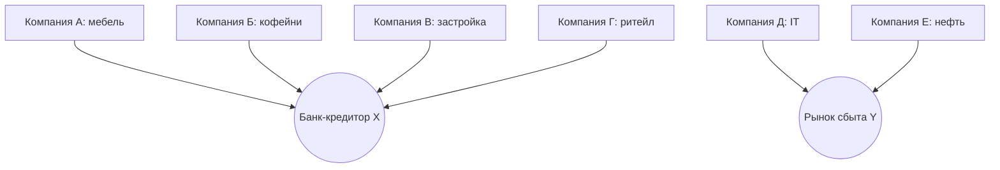
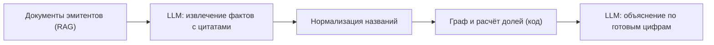

# Скрытая связность портфеля

AI читает отчётность эмитентов, находит общие зависимости (кредитор, рынок сбыта, валюта выручки) и показывает, сколько в портфеле независимых рисков на самом деле.

## Проблема

Диверсификацию обычно проверяют по числу бумаг и секторам. Но общая зависимость записана не в секторе, а в тексте отчёта, поэтому в спокойное время её не видно, а в кризис бумаги падают вместе.

Секторов шесть, независимых источников риска два. Пример иллюстративный: компании и связи выдуманы.

## Как это работает

LLM читает тексты и объясняет результат. Граф, доли и метрики считает обычный код. Факт без цитаты из документа отбрасывается.

## Первый эксперимент

- **Гипотеза:** группы по общим зависимостям из текстов точнее предсказывают совместные просадки в стрессе, чем сектора и корреляции цен.
- **Данные:** акции индекса Мосбиржи, отчёты только до начала стресса. Основной период: февраль–март 2020. Дополнительный: 2022 после возобновления торгов, с оговорками.
- **База сравнения:** группировка по секторам и кластеры по корреляциям за предыдущий год, число групп одинаковое.
- **Метрика:** AUC по парам бумаг (упали ли вместе).
- **Порог:** выигрыш не менее 0,05 над лучшей базой на обоих периодах, иначе идею меняем.

## Риски

- Скудное раскрытие у небольших эмитентов.
- Пропущенные или выдуманные моделью связи.
- Неясный спрос пользователей.

Каждый риск проверяем до основной разработки.
